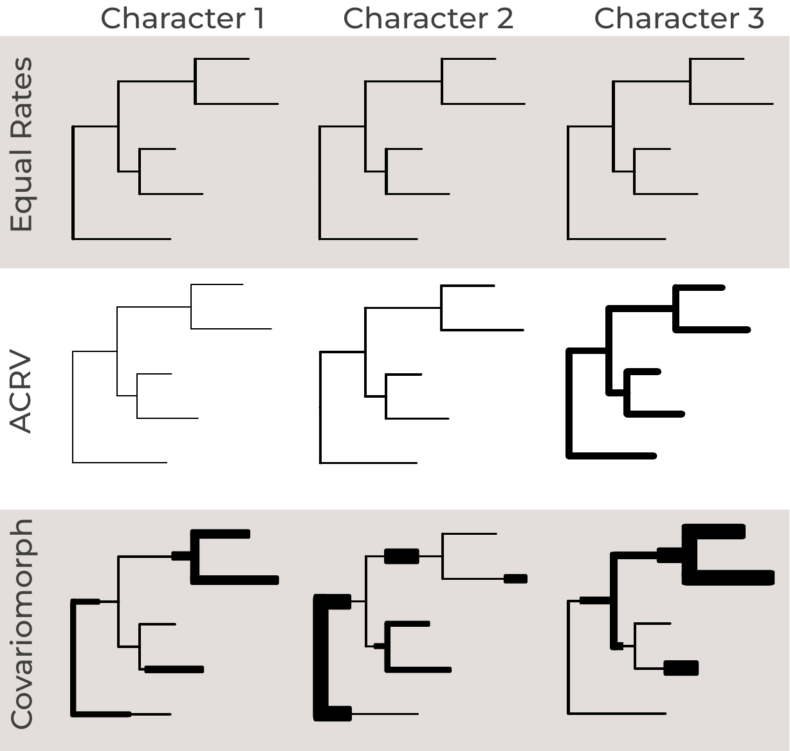
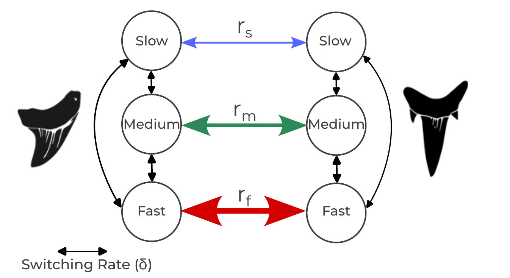
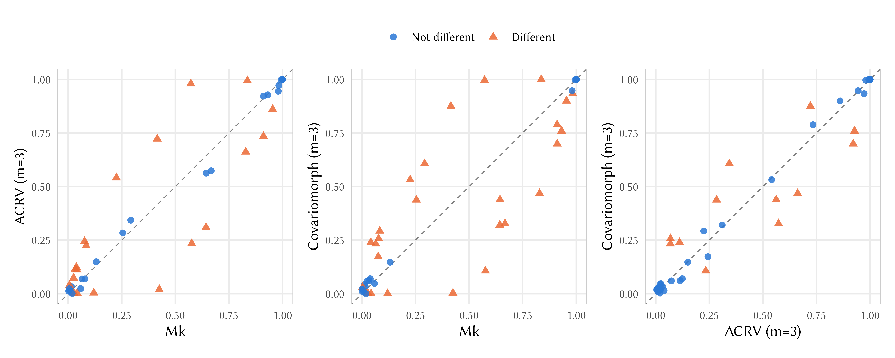



 let each *character* have its own,
fixed rate of evolution, drawn once from a Gamma (or lognormal)
distribution and never changing thereafter. That is already an
improvement on the plain Mk model, but it still assumes that a
character's rate is constant over the entire tree: a character that
evolves quickly does so on every branch, forever.

Real characters are not always so well-behaved. A structure can be under
strong selective constraint in one part of a tree and released from that
constraint elsewhere -- for example, a structure that is functionally
important in one lineage but vestigial in another may evolve slowly in
the first and quickly in the second. The same character can also become
"locked" for long stretches of time (because a developmental or
functional dependency makes any change deleterious) and later become free
to vary again. When the rate of a character changes across the tree in
this way, we speak of **heterotachy** (literally, "different speeds").
 contrasts this with the models of
the previous tutorials.




How models of morphological evolution treat evolutionary rates, shown
for three characters. The thickness of a branch indicates how fast a
character evolves along it. Under the Mk model (Equal Rates), all
characters evolve at the same rate on every branch. Under the ACRV
model, characters differ in their rate, but each character keeps its
rate across the whole tree. Under the covariomorph model, the rate of
each character can also change along the tree, so every character has
its own pattern of fast and slow branches. Modified from
, inspired by .



Because the underlying cause of such a rate shift (a change in function,
in developmental context, or in selective regime) is usually not itself
observable, we model it as a **hidden process**: a character's rate of
evolution is allowed to switch between a small number of hidden rate
categories as it evolves along the tree, and we never get to see which
category was in effect at any point in time -- only the resulting
character states at the tips. This is the **covarion model**. The idea
goes back to , who noticed that only a subset of
codons in a gene appeared free to vary at any one time ("concomitantly
variable codons", hence *covarion*), and that this subset itself changed
over time.  turned this idea into a formal
continuous-time Markov model of sequence evolution. Hidden rate classes
have also been used for single morphological characters, e.g., in
's study of plant growth-form transitions.
 extended the covarion model to phylogenetic
inference from whole matrices of discrete morphological characters,
under the name **covariomorph model**; this tutorial follows their
implementation in RevBayes.





It helps to start by being precise about how this differs from the ACRV
model of :

- **ACRV** draws one rate multiplier per *character*, once, at the root,
  and that character keeps that rate for the entire tree. Different
  characters can have different (fixed) rates.
- **Covarion** also assigns each character one of the same kind of rate
  multipliers, but that rate category is itself a Markov process along
  the tree: the character can switch to a different rate category on
  any branch, at some estimated switching rate.

In other words, ACRV models variation in rate *among characters*, while
the covarion model additionally models variation in rate *within a
character, over time*. As we will see below, ACRV is in fact a special
case of the covarion model.



Consider a character with $k$ observable states (for a binary character,
$k=2$: states 0 and 1), and suppose there are $m$ hidden rate categories
(called `NUM_CATEGORIES` in our scripts) with rate multipliers
$r_1, r_2, \ldots, r_m$. Under the covariomorph model, at any moment in
time the character is in a **compound state** $(x, c)$, made up of

- its *observed* morphological state $x \in \lbrace0, \ldots, k-1\rbrace$, which
  is what we score in the character matrix, and
- its *hidden* rate category $c \in \lbrace1, \ldots, m\rbrace$, which we never
  observe.

The compound process therefore has $k \times m$ states. Over a short
interval of time, exactly one of two kinds of event can happen:

1. **A change in the observed state, within the current rate
   category.** The character changes from $x$ to $x'$ while staying in
   category $c$. This happens at rate $r_c \, Q^{(c)}_{x x'}$, where
   $Q^{(c)}$ is an ordinary Mk-type rate matrix for category $c$. A
   character in a slow category ($r_c$ small) rarely changes state; a
   character in a fast category ($r_c$ large) changes state often.
2. **A switch of the hidden rate category, without any change in the
   observed state.** The character moves from category $c$ to category
   $d$ while keeping its state $x$. This happens at the switching rate
   $s_{cd}$.

Changing the observed state *and* the rate category in the same instant
is not allowed (it has rate zero), just as two nucleotides changing
simultaneously is not allowed in a standard substitution model.




The covariomorph process for a binary character (here, two shapes of a
shark tooth) with three hidden rate categories: slow, medium and fast.
Within each category, the character changes between its two observed
states at the rate of that category ($r_s$, $r_m$ and $r_f$ for slow,
medium and fast; the thickness of the horizontal arrows). Independently,
the character can switch between rate categories without changing its
observed state, at the switching rate $\delta$ (black arrows). Modified
from .





If we order the $k \times m$ compound states in blocks -- first all $k$
observed states in category 1, then all $k$ observed states in category
2, and so on -- the two kinds of events above give the rate matrix a
simple block structure. The blocks on the diagonal describe state changes
within a category, and the off-diagonal blocks describe category
switches, which are diagonal matrices (scaled identity matrices $I$)
because a switch never changes the observed state:

$$
Q = \left(
\begin{array}{c|c|c|c}
r_1 Q^{(1)} & s_{12} I & \cdots & s_{1m} I \\
\hline
s_{21} I & r_2 Q^{(2)} & \cdots & s_{2m} I \\
\hline
\vdots & \vdots & \ddots & \vdots \\
\hline
s_{m1} I & s_{m2} I & \cdots & r_m Q^{(m)} \\
\end{array}
\right)
$$

(the diagonal elements of the full matrix are, as always, set so that
each row sums to zero).

To make this concrete, take a binary character ($k=2$) with $m=2$ hidden
rate categories, a "slow" category with rate $r_1$ and a "fast" category
with rate $r_2$, Jukes-Cantor-type state changes within each category,
and switching rates $s_{12}$ (slow to fast) and $s_{21}$ (fast to slow).
Writing the four compound states as $(0,\text{slow})$, $(1,\text{slow})$,
$(0,\text{fast})$, $(1,\text{fast})$, the full rate matrix is

$$
Q = \left(
\begin{array}{cc|cc}
-(r_1 + s_{12}) & r_1 & s_{12} & 0 \\
r_1 & -(r_1 + s_{12}) & 0 & s_{12} \\
\hline
s_{21} & 0 & -(r_2 + s_{21}) & r_2 \\
0 & s_{21} & r_2 & -(r_2 + s_{21}) \\
\end{array}
\right)
$$

Notice the zeros: a character cannot go directly from $(0,\text{slow})$
to $(1,\text{fast})$; it must first change its state and then switch
category (or vice versa), as two separate events. (In the model we use
below, the two switching rates are equal, $s_{12} = s_{21}$; see
.)



The covariomorph model as we implement it here has two kinds of free
parameters beyond the tree and its branch lengths.

**The rate multipliers $r_1, \ldots, r_m$.** Exactly as in the ACRV
model of , we do not estimate each $r_c$
separately. Instead, we obtain them by discretizing a continuous
distribution into $m$ equal-probability categories and taking a
representative value from each. Here we use a lognormal distribution
with a median of 1 whose standard deviation $\sigma$ (on the log scale,
called `sd_morpho` in our scripts) controls how different the categories
are from each other: a small $\sigma$ gives categories with nearly
identical rates, while a large $\sigma$ gives a mixture of
nearly-invariable and very fast categories. The discretized values are
then rescaled to have a mean of exactly 1, so that, on average, branch
lengths keep their usual interpretation as the expected number of
character changes per character.

**The switching rates $s_{cd}$.** These govern how often a character
changes its rate category. We assume that a character is equally likely
to switch from its current category to any of the other $m-1$
categories, and parameterize all switching rates by a single parameter,
the switching rate $\delta$ (called `global_switch_rate` in our
scripts): the *total* rate of leaving the current category. Each
individual switching rate is then

$$
s_{cd} = \frac{\delta}{m-1} \quad \text{for } c \neq d.
$$

Because $\delta$ is the total rate of leaving a category, its meaning
does not depend on $m$: along a branch of length $v$, a character is
expected to switch rate category about $\delta v$ times. For example, a
switching rate of $\delta = 1$ means that a character switches category
about as often as it changes state in a category with average rate. This
lets us keep the same prior on $\delta$ if we later change the number of
categories.

Because the switching rates are symmetric, the hidden process spends, in
the long run, an equal amount of time in each category. That is, the
stationary probability of each category is $1/m$, which is also the
probability with which we assume each character starts in each category
at the root of the tree -- exactly the equal-probability categories of
the ACRV model.



It is useful to think about what happens at the two extremes of the
switching rate, because they connect the covariomorph model to the
models you already know:

- **No switching ($\delta \to 0$).** A character never leaves the
  category it starts in at the root. Each character therefore evolves
  at a single rate $r_c$ for the whole tree, with each category equally
  likely: this is the ACRV model of 
  (with lognormal instead of Gamma rates, and without the
  ascertainment-bias correction; see ).
- **Very fast switching ($\delta \to \infty$).** A character switches
  categories so often that, over any appreciable stretch of branch, it
  experiences the *average* rate of all categories, which is 1. All
  characters then behave identically, and the model collapses to the
  plain Mk model with no rate variation at all.

The interesting, covarion-like behavior lies between these extremes:
switching that is slow enough that a character stays in one category for
a meaningful stretch of the tree, but fast enough that it does switch at
least occasionally across the tree. Estimating $\delta$ alongside the
tree tells us where in this range our data fall. This is also why a
covariomorph analysis needs enough data to be informative: the signal
for switching comes from characters that appear conserved in one part
of the tree but labile in another.

Because the Mk and ACRV models are both nested within the covariomorph
model, we do not need to decide in advance whether our data contain
covarion-like signal. If they do not, the covariomorph model simply
reduces to one of the simpler models: to ACRV if characters differ in
rate but do not switch, and to Mk if they do not differ in rate at all.
As we will see in  and
, the priors we use are chosen so that the
model leans towards the Mk model unless the data clearly support rate
variation and rate switching.



Because the hidden rate category is never observed, we cannot simply
plug the scored states into the expanded $(km) \times (km)$ rate matrix.
Instead, RevBayes **expands** each observed state into all of the
compound states that are compatible with it. A tip scored as state 1,
for example, could be in $(1, c)$ for any category $c$, so its tip
likelihood vector has a 1 in each of those $m$ positions and a 0
everywhere else -- in exactly the same way that an ambiguous or missing
score is handled in a standard analysis. The usual pruning algorithm,
run on the expanded $k \times m$ state space, then automatically sums
("marginalizes") over every possible hidden-category history at every
internal node and along every branch .

This has a computational cost. Each transition-probability calculation
now involves a $(km) \times (km)$ matrix instead of a $k \times k$ one,
so a covariomorph analysis with $m = 3$ categories is considerably
slower than the equivalent Mk or ACRV analysis. Keep $m$ small (3 or 4
is a common choice) unless you have a good reason to do otherwise.



>Download the data file [`snakes.nex`](data/snakes.nex) and save it to
>your `data` directory.
{:.instruction}

`snakes.nex` contains 234 morphological characters scored for 21 taxa
. The matrix was assembled to place the giant
Pleistocene Australian snake *Wonambi* (Madtsoiidae) and to study the
early evolution of snakes. It contains 17 extant snake lineages, three
fossil taxa (Pachyophiidae, Madtsoiidae and *Dinilysia*), and a
hypothetical outgroup called `Ancestor`, which the original authors used
to root the tree. Of the characters, 156 are binary, 70 have three
states and 8 have four states, so -- exactly as in
 -- we partition the matrix by the
number of states. All characters are treated as unordered: the
covariomorph model uses an unordered (Mk-type) rate matrix within each
rate category.



>Create the Rev-script files **model_Covariomorph_partition.Rev** and
>**mcmc_covariomorph.Rev** in your `scripts` directory.
{:.instruction}

We continue to reuse the shared tree model, `model_tree.Rev`, from
. `model_Covariomorph_partition.Rev` specifies the
substitution model, and we build it in three steps: the hidden rate
categories, the switching rate, and finally one covariomorph Q matrix per
state-count partition.



First, we need the rate multiplier associated with each hidden rate
category. As in , we discretize a
distribution -- here a lognormal -- into `NUM_CATEGORIES` values (we set
`NUM_CATEGORIES = 3` in `mcmc_covariomorph.Rev`, the same three categories
as in ). The `normalize` function
rescales the discretized values so that their mean is 1.

Following , we do not place the prior on the
standard deviation $\sigma$ (`sd_morpho`) itself, but on its inverse,
`inverse_sd`, which gets a uniform prior between 0 and 1000. Because
$\sigma = 1/$`inverse_sd`, most of this prior's weight lies on very small
values of $\sigma$: a priori, there is a 90% probability that
$\sigma < 0.01$, i.e., that all categories have practically the same
rate. In other words, the prior favors the Mk model, and the analysis
only finds rate variation among the categories if the data clearly
support it.

inverse_sd ~ dnUniform(0, 1E3)
inverse_sd.setValue(1)
moves.append( mvScale(inverse_sd, lambda=0.5, weight=4) )
moves.append( mvScale(inverse_sd, lambda=2.0, weight=4) )
sd_morpho := 1 / inverse_sd
rate_scalars := normalize(fnDiscretizeDistribution(dnLognormal(0.0, sd_morpho), NUM_CATEGORIES))


>To get a feeling for what $\sigma$ (`sd_morpho`) does, type `rate_scalars`
>in the RevBayes console. Then set $\sigma$ to 0.1 with
>`inverse_sd.setValue(1/0.1)` and look at `rate_scalars` again, and then
>do the same for $\sigma = 5$ (`inverse_sd.setValue(1/5)`). For small
>$\sigma$, all three multipliers are close to 1. For large $\sigma$, the
>two slow categories are practically invariable and only the fastest
>category changes at all. Set `inverse_sd.setValue(1)` again when you
>are done.
{:.instruction}



Next, the switching rate. As described in ,
`global_switch_rate` is the *total* rate of leaving the current category,
and we divide it evenly among the `NUM_CATEGORIES - 1` other categories.
Following , `global_switch_rate` gets a very
wide uniform prior between 0 and 10,000. This allows everything from
"never switches" (the ACRV limit, $\delta \to 0$) to "switches
constantly" (the Mk limit, $\delta \to \infty$; see
), and puts almost all of the prior weight on
very fast switching: a priori, there is only a 0.05% probability that
$\delta < 5$. Together with the prior on $\sigma$, the model therefore
reduces to the Mk model when the data contain no signal for rate
switching, and the switching rate then simply drifts towards its prior
mean of 5,000.

We start the MCMC at a switching rate of 0.001, close to the ACRV limit.
If the switching rate then moves away from this starting value, you know
that the data, not the starting value, put it there. Because the
switching rate may have to travel across several orders of magnitude,
we use two scale moves with different tuning parameters (`lambda`), one
proposing small and one proposing large changes.

global_switch_rate ~ dnUniform(0, 1E4)
global_switch_rate.setValue(0.001)
moves.append( mvScale(global_switch_rate, lambda=0.5, weight=4) )
moves.append( mvScale(global_switch_rate, lambda=2.0, weight=4) )
switching_rate := global_switch_rate * (1 / (NUM_CATEGORIES - 1))

You might wonder why we write `global_switch_rate * (1 / (NUM_CATEGORIES - 1))`
rather than the simpler `global_switch_rate / (NUM_CATEGORIES - 1)`.
RevBayes treats `NUM_CATEGORIES - 1` as an integer that could be
negative, so the simpler version produces a value of type `Real` rather
than `RealPos` (a positive real number). `fnCovarion` only accepts
positive switching rates, and with the simpler version it stops with the
error message "Argument or label mismatch for function call". If you see
this error in your own scripts, check the types of your variables with
`type()`.

We then fill in the $m \times m$ matrix of switching rates $s_{cd}$, with
zeros on the diagonal (a "switch" from a category to itself is not an
event):

for (i in 1:NUM_CATEGORIES) {
    for (j in 1:NUM_CATEGORIES) {
        if (i == j) {
            switch_rates[i][j] := 0
        } else {
            switch_rates[i][j] := switching_rate
        }
    }
}

The rate categories and the switching rate are shared by all partitions:
a 2-state and a 4-state character draw from the same set of rate
categories and switch between them at the same rate.



Now we partition the matrix by the number of states, as in
. For each possible number of states
`i+1`, we make a copy of the data and keep only the characters with that
many states (more precisely, the characters whose largest state is `i`;
see ):

max_states = morpho.getStateDescriptions().size()
idx = 1


partition_state[i] = morpho
partition_state[i].setNumStatesPartition(i+1)

There is one subtlety here that does not arise for the plain Mk model:
`setNumStatesPartition()` only restricts *which* characters are included
in a partition, but does not, on its own, update the partition's internal
state-space bookkeeping that `expandCharacters()` (see below) relies on.
If you skip the step below, `expandCharacters()` will silently expand
each partition as though it still had as many states as the *original*,
un-partitioned matrix. So, for each partition, we write it to file and
read it back in before expanding it, which forces RevBayes to recompute
its state descriptions from scratch:

temp_data <- partition_state[i]
temp_data.removeExcludedCharacters()
nc = temp_data.nchar()

if (nc > 0) {
    writeNexus(filename="output/covariomorph_partition_" + (i+1) + "_states.nexus", temp_data)

    partition_state[i] = readDiscreteCharacterData("output/covariomorph_partition_" + (i+1) + "_states.nexus")


Every rate category of a partition shares the same (here, Jukes-Cantor)
character-state model $Q^{(c)}$ of size `i+1`; only the rate $r_c$ at
which that model runs differs between categories. `fnCovarion` then
assembles the per-category Q matrices, the rate scalars, and the
switching rates into the expanded, block-structured covariomorph Q
matrix of . We set `rescaled=FALSE` because the
rate scalars already have a mean of 1, so the matrix does not need any
further rescaling:

for (j in 1:NUM_CATEGORIES) {
  Q_sub[idx][j] := fnJC(i+1)
}

Q_morpho[idx] := fnCovarion(Q_sub[idx], RateScalars=rate_scalars, SwitchRates=switch_rates, rescaled=FALSE)


Finally, because we only ever observe a character's state, not its
hidden rate category, we `expandCharacters()` the data (turning each
observed state into every compound state it is consistent with, as
described in ) and let `dnPhyloCTMC`
marginalize over the hidden category for us. Because the character data
are now indexed by these compound (state, category) integers rather than
the letters/digits of a "Standard" morphological matrix, we use
`type="NaturalNumbers"` instead of `type="Standard"`.

phyMorpho[idx] ~ dnPhyloCTMC(tree=phylogeny, Q=Q_morpho[idx], nSites=nc, type="NaturalNumbers")

expanded_partition_state[idx] = partition_state[i].expandCharacters(NUM_CATEGORIES)

phyMorpho[idx].clamp(expanded_partition_state[idx])


>After sourcing the model file, type `Q_morpho[1]` in the RevBayes
>console to see the $6 \times 6$ covariomorph matrix for the binary
>characters ($k = 2$ states times $m = 3$ categories), and
>`expanded_partition_state[1].show()` to see the expanded data. Each
>observed state 0 has become the ambiguity `(0 2 4)` -- state 0 in any
>of the three categories -- and each observed state 1 has become
>`(1 3 5)`.
{:.instruction}

Note that we do not use the ascertainment-bias correction
(`coding="variable"`) of : it is not yet
available for the covariomorph model, so the covariomorph model is an
extension of the *Mk* model, not of the Mkv model. We explain why at the
end of this tutorial, in .



`mcmc_covariomorph.Rev` follows the same structure as every `mcmc_*.Rev`
script earlier in this tutorial series. To see whether the covariomorph
model makes a difference, we will run it three times: once with the
covariomorph model, and once with each of the two simpler models nested
within it (see ). We therefore start the
script by choosing the model, and the number of rate categories:

MODEL = "Covariomorph"


NUM_CATEGORIES = 3

Next, we read the data, and source the tree model and the substitution
model. The name of the model file is built from the value of `MODEL`:

morpho = readDiscreteCharacterData("data/snakes.nex")


source("scripts/model_tree.Rev")


source("scripts/model_" + MODEL + "_partition.Rev")

For `MODEL = "Covariomorph"`, this sources the model file we just built.
The two other model files are provided:
[`model_ACRV_partition.Rev`](scripts/model_ACRV_partition.Rev) uses
exactly the same lognormal rate categories, with the same prior, but
without any switching between them, and
[`model_Mk_partition.Rev`](scripts/model_Mk_partition.Rev) uses the plain
Mk model. Like the covariomorph model, both are partitioned by the
number of states and do not use the ascertainment-bias correction (see
), so that the three models differ only
in how they treat rate variation.

The output filenames also contain the name of the model, so that the
three analyses do not overwrite each other:

monitors.append( mnModel(filename="output/snakes_" + MODEL + ".log", printgen=10) )
monitors.append( mnFile(filename="output/snakes_" + MODEL + ".trees", printgen=10, phylogeny) )
monitors.append( mnScreen(printgen=1000, tree_length) )

The rest of the script runs two independent MCMC chains and summarizes
the sampled trees, exactly as before:

mymcmc = mcmc(mymodel, monitors, moves, nruns=2, combine="mixed")
mymcmc.run(generations=20000, tuningInterval=200)


>Download [`model_ACRV_partition.Rev`](scripts/model_ACRV_partition.Rev)
>and [`model_Mk_partition.Rev`](scripts/model_Mk_partition.Rev) into your
>`scripts` directory. Then run `source("scripts/mcmc_covariomorph.Rev")`
>three times, with `MODEL` set to `"Covariomorph"`, `"ACRV"` and `"Mk"`. If
>your computer has several cores, you can run the three analyses at the
>same time in separate RevBayes sessions. On our computer, the Mk
>analysis took about 3 minutes, the ACRV analysis about 10 minutes, and
>the covariomorph analysis about 30 minutes: with three rate categories,
>the largest Q matrix of the covariomorph model (for the four-state
>characters) has $4 \text{ states} \times 3 \text{ categories} = 12$
>rows and columns.
{:.instruction}





Load `output/snakes_Covariomorph_run_1.log` and
`output/snakes_Covariomorph_run_2.log` into `Tracer`. First, check that the
two runs have converged to the same distribution (see
). Then look at the two new parameters, and
use the limiting cases of  to interpret them
together:

| $\sigma$ (`sd_morpho`) | $\delta$ (`global_switch_rate`) | The model behaves like ... |
|-------------|----------------------|----------------------------|
| close to 0  | (irrelevant)         | Mk: all categories have the same rate, so there is nothing to switch between |
| clearly > 0 | close to 0           | ACRV: characters differ in rate but never switch |
| clearly > 0 | very large           | Mk: switching is so fast that every character experiences the average rate |
| clearly > 0 | moderate             | covarion: characters switch rate category a few times across the tree |

For the snake data:

- **`sd_morpho` is clearly above zero**, even though its prior puts most
  of its weight on values very close to zero
  (see ). The characters therefore evolve at
  different rates. To see what this means, look at the rate multipliers
  themselves (`rate_scalars[1]` to `rate_scalars[3]` in the log files),
  and compare the slowest with the fastest category.
- **`global_switch_rate` is moderate**: it has moved far away both from
  its starting value of 0.001 (the ACRV limit) and from the very large
  values that its prior favors (the Mk limit). Its posterior lies around
  1, which means that a character switches its rate category about as
  often as it changes its state. To put this into context, multiply it
  by the tree length: this gives the number of times a typical character
  is expected to switch its rate category across the whole tree. For
  the snakes, this is several times -- a typical character is fast in
  some parts of the snake tree and slow in others.

The snake data are therefore in the covarion-like region of the table:
they contain signal both for rate variation among characters and for
switching between rate categories along the tree.



The estimates above tell us that the snake data contain covarion-like
signal, but not whether this changes our conclusions about the
phylogeny. To find out, we compare the posterior probabilities of all
clades sampled under the three models, following
.

>Run the R script [`plot_clade_posteriors.R`](scripts/plot_clade_posteriors.R)
>from the same directory in which you ran RevBayes:
>`Rscript scripts/plot_clade_posteriors.R`. It requires the R packages
>`ape`, `ggplot2`, `patchwork` and `convenience` .
{:.instruction}




Posterior probabilities of the clades sampled under the Mk, ACRV and
covariomorph models for the snake data, compared between each pair of
models. Each point is a clade, and its position shows the clade's
posterior probability under the model named on the x-axis and under the
model named on the y-axis; points on the dashed diagonal have the same
posterior probability under both models. Triangles mark clades whose
posterior probabilities differ by more than expected from the randomness
of the MCMC alone (for an effective sample size of 200), as in
.



 shows three comparisons:

- **Mk vs. ACRV (left).** Allowing characters to evolve at different
  rates changes the posterior probabilities of many clades. This is the
  effect of rate variation *among characters*, which you already saw in
  .
- **Mk vs. covariomorph (middle).** The covariomorph model changes the
  posterior probabilities of even more clades.
- **ACRV vs. covariomorph (right).** This is the most interesting
  comparison: the two models share exactly the same rate categories and
  differ *only* in whether characters can switch between them. Several
  clades still differ, some of them substantially. This shows that for
  the snakes, it is the switching -- heterotachy -- itself that changes
  which relationships are supported, not only the rate variation among
  characters.

Which clades are these? Open `output/snakes_ACRV.majrule.tre` and
`output/snakes_Covariomorph.majrule.tre` in `FigTree`, root both trees on
`Ancestor`, and compare the support for the clades containing the blind
snakes (Anomalepididae, Leptotyphlopidae, Typhlopidae) and the other
small burrowing snakes (*Anomochilus*, Uropeltidae and *Cylindrophis*).
Under the covariomorph model, the support for grouping these burrowing
snakes together drops. Can you think of a reason why a model that allows
characters to speed up in some lineages might be less convinced by the
similarities between burrowing snakes?

Two caveats are worth keeping in mind. First, a few of the triangles,
especially in comparisons with the Mk model, may still be due to the
randomness of the MCMC: the Mk analysis mixes less well than the other
two, and longer runs would reduce this. Second, none of the three
analyses corrects for ascertainment bias (see
).





We used `NUM_CATEGORIES = 3` hidden rate categories. Because
`global_switch_rate` is defined as the *total* rate of leaving a
category (see ), its prior keeps the same
meaning if we change the number of categories. Try rerunning the
analysis with `NUM_CATEGORIES = 2` or `4` (remember to change the output
filenames, e.g., to `output/snakes_Covariomorph_4cats*`). Does the posterior of `global_switch_rate` change? How much
faster is the analysis?



Not every dataset contains covarion-like signal. The binary bears
dataset used in , 
and  is an example. It is a
good way to see what happens when the covariomorph model is applied to
such data: as explained in , it should simply
reduce to the Mk model. Because all of its characters are binary, the
partitioning loop of `model_Covariomorph_partition.Rev` simply creates a
single partition with $2 \times 3 = 6$ compound states, so we can use
the same model file as for the snakes.

>Make a copy of `mcmc_covariomorph.Rev` called
>`mcmc_covariomorph_bears.Rev`. In the copy, read `data/bears.nex`
>instead of `data/snakes.nex`, and change `snakes` to `bears` in all
>output filenames. Run it with `MODEL = "Covariomorph"`, and look at the
>posteriors of `global_switch_rate` and `sd_morpho`. How do they differ
>from what you saw for the snake data? Which of the limiting cases in
> does the model end up in?
{:.instruction}



In , we saw that morphological matrices usually
contain only variable characters, because invariant characters are
rarely recorded, and that the Mk model has to be corrected for this
. Ignoring this ascertainment bias leads to severely
overestimated branch lengths  and can also affect the
posterior probabilities of clades . The
correction, which turns the Mk model into the Mkv model, conditions the
likelihood of each character on the fact that the character is
variable:

$$
P(\text{data}_i \mid \text{tree}, \text{variable}) =
\frac{P(\text{data}_i \mid \text{tree})}{1 - P(\text{invariant} \mid \text{tree})}
$$

Under the Mk model, the probability of observing an invariant character
is easy to compute: a $k$-state character has only $k$ invariant
patterns (all taxa in state 0, all taxa in state 1, and so on).

Under the covariomorph model, this is more complicated. Remember that we
expand every observed state into all of the compound states it is
consistent with (see ). A binary
character that is observed as invariant -- say, all taxa in state 0 --
can therefore correspond to any combination of hidden rate categories at
the tips: with three rate categories and $n$ taxa, there are
$2 \times 3^n$ such patterns instead of 2. Although the pruning
algorithm can, in principle, sum over these patterns as quickly as it
computes the likelihood of a single character ,
deriving the correct conditioning for a model in which characters are
spread over several rate categories is not trivial: as
 showed for among-character rate variation,
whether one conditions on each rate category separately or on the
mixture as a whole introduces different biases. An ascertainment-bias
correction for the covariomorph model has therefore not yet been
derived and implemented .

Until it is available, keep in mind that all covariomorph analyses,
like the Mk analyses we compared them with, are uncorrected. Absolute
branch lengths and tree lengths from these analyses are therefore likely
to be overestimated, and they should not be compared directly with the
results of Mkv analyses.

This concludes the discrete-morphology tutorial series. From here, you
may want to continue to  to see how these same
substitution models are used for ancestral-state estimation.
