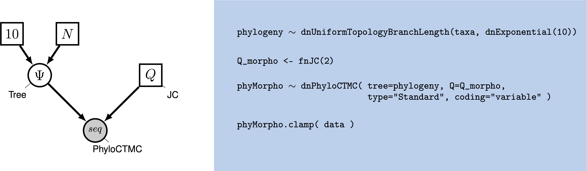



While molecular data have become the default for building phylogenetic
trees for many types of evolutionary analysis, morphological data
remains important, particularly for analyses involving fossils. The use
of morphological data raises special considerations for model-based
methods for phylogenetic inference. Morphological data are typically
collected to maximize the number of parsimony-informative characters -
that is, the characters that provide information in favor of one
topology over another. Morphological characters also do not carry common
meanings from one character in a matrix to the next; character codings
are made arbitrarily. These two factors require extensions to our
existing phylogenetic models. Accounting for the complexity of
morphological characters remains challenging. This tutorial will provide
a discussion of modeling morphological characters, and will demonstrate
how to perform Bayesian phylogenetic analysis with morphology using
RevBayes .




This is the first of six tutorials on discrete morphological character
evolution, each building on the previous one:

1. **This tutorial** introduces the Mk model and ascertainment-bias correction.
2.  adds among-character rate variation (ACRV).
3.  shows how to analyze characters with different numbers of states by partitioning the matrix.
4.  models ordered characters, which can only change between adjacent states, alongside unordered ones.
5.  adds among-character state-frequency variation (asymmetric rates of change) for binary characters, and combines it with partitioning by number of states.
6.  introduces the covariomorph model, in which a character's evolutionary rate can itself change over time.

Each page in this series reuses the tree model (`scripts/model_tree.Rev`)
introduced below, and only changes the morphological substitution model.







Graphical model showing the Mk model (left panel).
Rev code specifying the Mk model is on the right-hand panel.



Molecular data forms the basis of most phylogenetic analyses today.
However, morphological characters remain relevant: Fossils often provide
our only direct observation of extinct biodiversity; DNA degradation can
make it difficult or impossible to obtain sufficient molecular data from
fragile museum specimens. Using morphological data can help researchers
include specimens in their phylogeny that might be left out of a
molecular tree.

To understand how morphological characters are modeled, it is important
to understand how characters are collected. Unlike in molecular data,
for which homology is algorithmically determined, homology in a
character is typically assessed by an expert. Biologists will typically
decide what characters are homologous by looking across specimens at the
same structure in multiple taxa; they may also look at the developmental
origin of structures in making this assessment . Once
homology is determined, characters are broken down into states, or
different forms a single character can take. The state `0` commonly
refers to absence, meaning that character is not present. In some
codings, absence will mean that character has not evolved in that group.
In others, absence means that that character has not evolved in that
group, and/or that that character has been lost in that group
. This type of coding is arbitrary, but both
*non-random* and *meaningful*, and poses challenges for how we model
the data.

Historically, most phylogenetic analyses using morphological characters
have been performed using the maximum parsimony optimality criterion.
Maximum parsimony analysis involves proposing trees from the
morphological data. Each tree is evaluated according to how many changes
it implied in the data, and the tree that requires the fewest changes is
preferred. In this way of estimating a tree, a character that does not
change, or changes only in one taxon, cannot be used to discriminate
between trees (i.e., it does not favor a topology). Therefore, workers
with parsimony typically do not collect characters that are parsimony
uninformative.

In 2001, Paul Lewis  introduced a generalization of the
Jukes-Cantor model of sequence evolution for use with morphological
data. This model, called the Mk (Markov model, assuming each character
is in one of *k* states) model provided a mathematical formulation that
could be used to estimate trees from morphological data in both
likelihood and Bayesian frameworks. While this model is a useful step
forward, as a generalization of the Jukes-Cantor, it still makes fairly
simplistic assumptions. This tutorial series will guide you through
estimating a phylogeny with the Mk model, and a series of increasingly
realistic extensions to the model, culminating in the covariomorph model
in .




The Mk model is a generalization of the Jukes-Cantor model of nucleotide
sequence evolution, which we discussed in .
The Q matrix for a two-state Mk model looks like so:

$$Q = 
\begin{pmatrix}
    -\mu_0 & \mu_{01} \\
    \\
    \mu_{10} & -\mu_1 \\
\end{pmatrix} \mbox{  ,}$$

This matrix can be expanded to accommodate multi-state data, as well:

$$Q = \begin{pmatrix} -\mu_0 & \mu_{01} & \mu_{02} & \mu_{03} \\
\mu_{10} & -\mu_1  & \mu_{12} & \mu_{13} \\
\mu_{20} & \mu_{21} & -\mu_2  & \mu_{23} \\
\mu_{30} & \mu_{31} & \mu_{32} & -\mu_3
\end{pmatrix} \mbox{  ,}$$

However, the Mk model sets transitions to be equal from any state to any
other state. In that sense, our multistate matrix really looks like
this:

$$Q = \begin{pmatrix} -(k-1)\mu & \mu & \mu & \mu \\
\mu & -(k-1)\mu  & \mu & \mu \\
\mu & \mu & -(k-1)\mu  & \mu \\
\mu & \mu & \mu & -(k-1)\mu \\
\end{pmatrix} \mbox{  ,}$$

Because this is a Jukes-Cantor-like model , state
frequencies do not vary as a model parameter, all characters share the
same rate, and that rate does not change over time. The next four
tutorials in this series relax these assumptions in turn: page 2 lets
the rate vary among characters, page 3 shows how to analyze characters
that have different numbers of states, page 4 shows how to model ordered 
characters, page 5 lets the state frequencies of binary characters 
vary among characters (and combines this with the
partitioning scheme of page 3), and page 5 lets a character's rate
change over time along the tree. These
assumptions may seem unrealistic, but all models are a compromise between
reality and generalizability. Prior work has demonstrated that, in many
conditions, the Mk model (with some extensions) does perform adequately .
Because morphological characters do not carry common meaning across
sites in a matrix in the way that nucleotide characters do, making
assumptions that fit all characters is challenging. A visualization of
this simple model can be seen in .

We will first perform a phylogenetic analysis using the Mk model.



When Lewis first introduced the Mk model, he observed that branch
lengths on the trees were greatly inflated. The reason for this is that
when morphological characters are collected, characters that do not
vary, or vary in a non-parsimony-informative way (such as
autapomorphies) are excluded. Excluding these low-rate characters causes
the overall amount of evolution to be over-estimated. This causes an
inflation in the branch lengths .

Therefore, when performing a morphological phylogenetic analysis, it is
important to correct for this bias. There are numerous statistically
valid ways to perform this correction . Original corrections
simulated invariant and non-parsimony informative characters along the
proposed tree. The likelihood of these characters would then be
calculated and used to normalize the total likelihood value. RevBayes
implements a dynamic programming approach that calculates the same
likelihood, but does so faster.




In this example, we will use morphological character data from 18 taxa
of extinct bears . The dataset contains 62 binary
characters, a fairly typical dataset size for morphological characters.
This is the same dataset that pages 2 and 3 of this tutorial series will
also use, so that we can compare how each model extension affects the
same data.




This tutorial follows a specific format for issuing instructions and
information.

>The boxed instructions guide you to complete tasks that are not part of
>the RevBayes syntax, but rather direct you to create directories or
>files or similar.
{:.instruction}

Information describing the commands and instructions will be written in
paragraph-form before or after they are issued.

All command-line text, including all Rev syntax, are given in
`monotype font`. Furthermore, blocks of Rev code that are needed to
build the model, specify the analysis, or execute the run are given in
separate shaded boxes. For example, we will instruct you to create a
constant node called `example` that is equal to `1.0` using the `<-`
operator like this:
```
example <- 1.0
```



>On your own computer, create a directory called **data**.
>In this directory download the data
>files: [`bears.nex`](data/bears.nex).
{:.instruction}




>Create a new directory (in `RB_DiscreteMorphology_Tutorial`) called **scripts**.
>(If you do not have this folder, please refer to the directions in
>section .)
{:.instruction}

When you execute RevBayes in this exercise, you will do so within the
main directory you created (`RB_DiscreteMorphology_Tutorial`), thus,
if you are using a Unix-based operating system, we recommend that you
add the RevBayes binary to your path. Alternatively make sure that you set the
working directory to, for example, **RB_DiscreteMorphology_Tutorial** if this is
the directory you stored the scripts and data in.




In this exercise, you will work primarily in your text editor and
create a set of files that will be easily managed and interchanged. As
in the rest of this tutorial series, we split the analysis into a tree
model, a substitution model, and an MCMC script that ties the two
together:

-   `model_tree.Rev`: specifies the tree topology and branch-length prior. This
    file is reused, unchanged, by every page in this tutorial series.
-   `model_Mk.Rev`: specifies the plain Mk substitution model for binary characters.
-   `mcmc_mk.Rev`: loads the data, sources the two files above, and specifies
    the monitors and MCMC sampler.

All of the files that you will create are also provided in the
RevBayes tutorial here (see the top of this webpage).
Please refer to these files to verify or troubleshoot your own scripts.

>Open your text editor and create the Rev-script files **model_tree.Rev**,
>**model_Mk.Rev**, and **mcmc_mk.Rev** in the `scripts` directory.
>
>Enter the Rev code provided in this section in the new files.
{:.instruction}


In this section you will begin the `mcmc_mk.Rev` file and write the Rev
commands for loading in the taxon list and managing the data matrices.
Then, starting in section , you will move on to
specifying the tree and substitution models in their own files. Once the
model specifications are complete, you will complete the MCMC script
with the instructions given in section .




RevBayes uses the function `readDiscreteCharacterData()` to load a
data matrix to the workspace from a formatted file. This function can be
used for both molecular sequences and discrete morphological characters.
Import the morphological character matrix and assign it to the variable
`morpho`.

morpho <- readDiscreteCharacterData("data/bears.nex")





Before we begin writing the Rev scripts for each of the models,
we need to instantiate a couple “helper variables” that will
be used by downstream parts of our model specification.

Create a new constant node called `num_taxa` that is equal to the number
of species in our analysis (18) and a constant node called `num_branches` representing
the number of branches in the tree. We will also create a constant node of
the taxon names. This list will be used to initialize the tree.

taxa <- morpho.names()
num_taxa <- taxa.size()
num_branches <- 2 * num_taxa - 2

Next, create two workspace variables called `moves` and `monitors`. These variable
vectors containing all of the MCMC moves and monitors used
to propose new states for every stochastic node in the model graph.

moves    = VectorMoves()
monitors = VectorMonitors()

One important distinction here is that `moves` and `monitors` is part of the RevBayes
workspace and not the hierarchical model. Thus, we use the workspace
assignment operator `=` instead of the constant node assignment `<-`.




We will use the same tree model throughout this tutorial series, so it
lives in its own file, `model_tree.Rev`. First, we create a joint prior
on the branch lengths and tree topology. This should be familiar from
.

phylogeny ~ dnUniformTopologyBranchLength(taxa, branchLengthDistribution=dnExponential(10.0))

It is not necessary for this model, but often we want to monitor the tree length
too. The tree length represents the number of transitions that we expect per
character over the entire tree.

tree_length := phylogeny.treeLength()

We will also create several moves working on the topology and branch lengths.

moves.append( mvNNI(phylogeny, weight=num_branches) )
moves.append( mvSPR(phylogeny, weight=num_branches/5.0) )
moves.append( mvBranchLengthScale(phylogeny, weight=num_branches) )

Back in `mcmc_mk.Rev`, we load this file with `source()`.

source("scripts/model_tree.Rev")





Next, in its own file `model_Mk.Rev`, we will create a $Q$ matrix.
Recall that the Mk model is simply a generalization of the JC model.
Therefore, we will create a 2x2 $Q$ matrix using `fnJC`, which
initializes Q-matrices with equal transition probabilities between all
states.

Q_morpho <- fnJC(2)


Lastly, we set up the CTMC. This should also be familiar from the .
We see some familiar pieces: tree and $Q$ matrix.
We also have a new keyword: data type. The data type
argument specifies the type of data - in our case, "Standard", the
specification for morphology.

phyMorpho ~ dnPhyloCTMC(tree=phylogeny, Q=Q_morpho, type="Standard")
phyMorpho.clamp(morpho)

All of the components of the model are now specified. Back in
`mcmc_mk.Rev`, load this file too.

source("scripts/model_Mk.Rev")







We can now create our workspace model variable with our fully specified
model DAG. We will do this with the `model()` function and provide a
single node in the graph (`phylogeny`).

mymodel = model(phylogeny)

The object `mymodel` is a wrapper around the entire model graph and
allows us to pass the model to various functions that are specific to
our MCMC analysis.




The next important step for our Rev-script is to specify the
monitors and output file names. For this, we create a vector called
`monitors` that will each sample and record or output our MCMC.

The first monitor we will create will monitor every named random
variable in our model graph. This will include every stochastic and
deterministic node using the `mnModel` monitor. The only parameter that
is not included in the `mnModel` is the tree topology. Therefore, the
parameters in the file written by this monitor are all numerical
parameters written to a tab-separated text file that can be opened by
accessory programs for evaluating such parameters. We will also name the
output file for this monitor and indicate that we wish to sample our
MCMC every 10 cycles.

monitors.append( mnModel(filename="output/mk.log", printgen=10) )

The `mnFile` monitor writes any parameter we specify to file. Thus, if
we only cared about the branch lengths and nothing else (this is not a
typical or recommended attitude for an analysis this complex) we
wouldn't use the `mnModel` monitor above and just use the `mnFile`
monitor to write a smaller and simpler output file. Since the tree
topology is not included in the `mnModel` monitor (because it is not
numerical), we will use `mnFile` to write the tree to file by specifying
our `phylogeny` variable in the arguments.

monitors.append( mnFile(filename="output/mk.trees", printgen=10, phylogeny) )

The third monitor we will add to our analysis will print information to
the screen. Like with `mnFile` we must tell `mnScreen` which parameters
we'd like to see updated on the screen.

monitors.append( mnScreen(printgen=100) )





Once we have set up our model, moves, and monitors, we can now create
the workspace variable that defines our MCMC run. We do this using the
`mcmc()` function that simply takes the three main analysis components
as arguments.

mymcmc = mcmc(mymodel, monitors, moves, nruns=2, combine="mixed")

The MCMC object that we named `mymcmc` has a member method called
`.run()`. This will execute our analysis and we will set the chain
length to `30000` cycles using the `generations` option.

mymcmc.run(generations=30000, tuningInterval=200)

Once our Markov chain has terminated, we will want to summarize our output.
First, we load in the tree trace.

trace = readTreeTrace("output/mk.trees", treetype="non-clock")
trace.setBurnin(0.25)

Then, we compute the *maximum a posteriori* (*MAP*) tree and the *majority rule consensus* (MRC) tree.

mapTree(trace, file="output/mk.map.tre")
consensusTree(trace, file="output/mk.majrule.tre")

Finally, tell the program to quit using the `q()` function.

q()


>You made it! Save all of your files.
{:.instruction}




With all the parameters specified and all analysis components in place,
you are now ready to run your analysis. The Rev scripts you just
created will all be used by RevBayes.

>Begin by running the RevBayes executable. In Unix systems, type the
>following in your terminal (if the RevBayes binary is in your path):
>rb
{:.instruction}

Provided that you started RevBayes from the correct directory
(`RB_DiscreteMorphology_Tutorial`), you can then use the `source()`
function to feed RevBayes your Rev-script file (`mcmc_mk.Rev`).
```
    source("scripts/mcmc_mk.Rev")
```

This will execute the analysis and you should see the following output
(though not the exact same values):
```
> source("scripts/mcmc_mk.Rev")
   Processing file "scripts/mcmc_mk.Rev"
   Successfully read one character matrix from file 'data/bears.nex'
   Processing file "scripts/model_tree.Rev"
   Processing of file "scripts/model_tree.Rev" completed
   Processing file "scripts/model_Mk.Rev"
   Processing of file "scripts/model_Mk.Rev" completed
   
   Running MCMC simulation
   This simulation runs 2 independent replicates.
   The simulator uses 3 different moves in a random move schedule with 74.8 moves per iteration
   

Iter        |      Posterior   |     Likelihood   |          Prior   |    elapsed   |        ETA   |
----------------------------------------------------------------------------------------------------
0           |       -656.742   |       -657.173   |       0.430997   |   00:00:00   |   --:--:--   |
100         |       -412.078   |       -414.729   |         2.6513   |   00:00:00   |   --:--:--   |
200         |       -422.389   |       -424.915   |        2.52586   |   00:00:00   |   00:00:00   |
300         |       -433.957   |        -431.18   |        -2.7769   |   00:00:00   |   00:00:00   |
400         |        -425.28   |       -427.092   |        1.81206   |   00:00:00   |   00:00:00   |
500         |       -417.984   |       -415.711   |       -2.27329   |   00:00:01   |   00:00:59   |
600         |       -414.983   |       -419.392   |        4.40913   |   00:00:01   |   00:00:49   |
700         |       -422.544   |        -422.87   |       0.326072   |   00:00:01   |   00:00:41   |
800         |       -422.549   |       -423.407   |       0.858141   |   00:00:01   |   00:00:36   |
900         |       -414.236   |        -415.06   |       0.823311   |   00:00:01   |   00:00:32   |
1000        |       -419.517   |       -418.972   |      -0.544754   |   00:00:01   |   00:00:29   |

...
```
{:.Rev-output}

When the analysis is complete, RevBayes will quit and you will have a
new directory called `output` that will contain all of the files you
specified with the monitors ().




1. Run the MCMC analysis in RevBayes.
2. Look at the resulting files **mk_run_1.log** and **mk_run_2.log** in Tracer and check for convergence.
3. Look at the majority rule consensus tree stored **mk.majrule.tre** and the MAP tree stored in **mk.map.tre** in FigTree.




As discussed earlier in the section , we also need to
correct for ascertainment bias.

>Create a copy of `model_Mk.Rev` and call it **model_Mkv.Rev**. Create a copy
>of `mcmc_mk.Rev` and call it **mcmc_mkv.Rev**. You will need to modify the
>`Rev` code provided in this section in these files.
{:.instruction}

In `RevBayes` it is actually very simple to add a correction for ascertainment bias.
You only need to set the option `coding="variable"` in the `dnPhyloCTMC`. Coding specifies
what type of ascertainment bias is expected. We are using the `variable` correction,
as we have no invariant character in our matrix. If we also lacked
parsimony non-informative characters, we would use the coding `informative`.

phyMorpho ~ dnPhyloCTMC(tree=phylogeny, Q=Q_morpho, type="Standard", coding="variable")


>Remember to change all filenames for the output, e.g., from `output/mk.log` to `output/mkv.log`,
>and to change the `source()` call in `mcmc_mkv.Rev` to load `model_Mkv.Rev` instead of `model_Mk.Rev`.
{:.instruction}

That’s all you need to do! Now run this script in RevBayes.

When you are ready, move on to , where we relax
the assumption that every character shares exactly the same rate of change.
