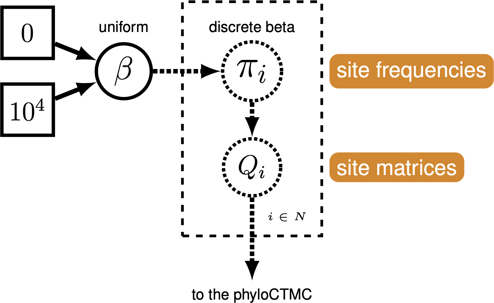
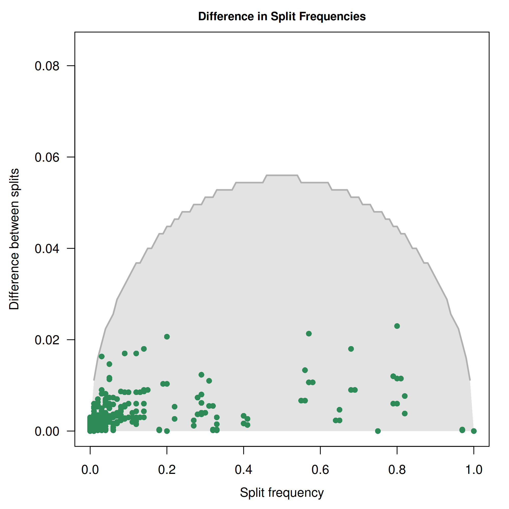
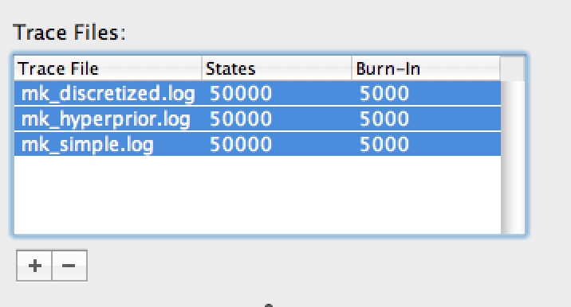
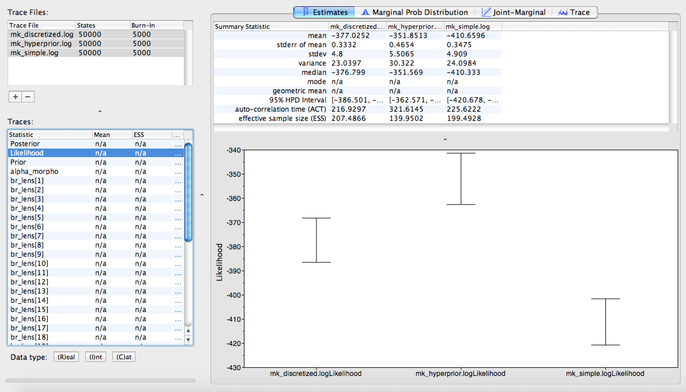
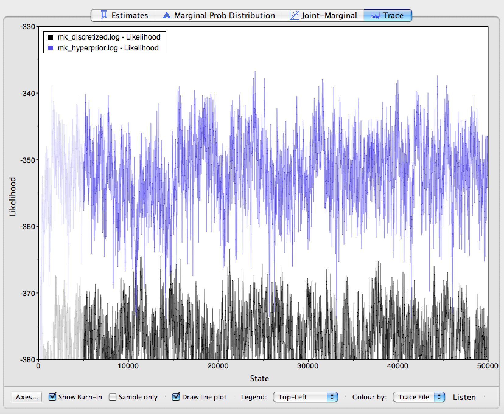
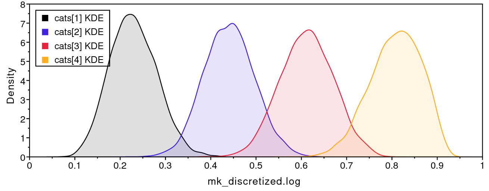
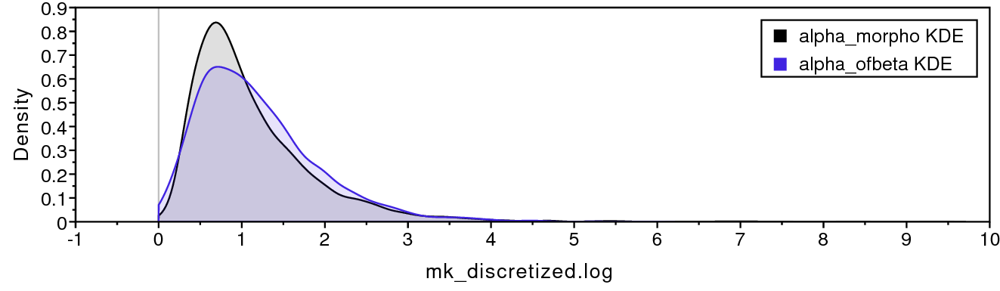
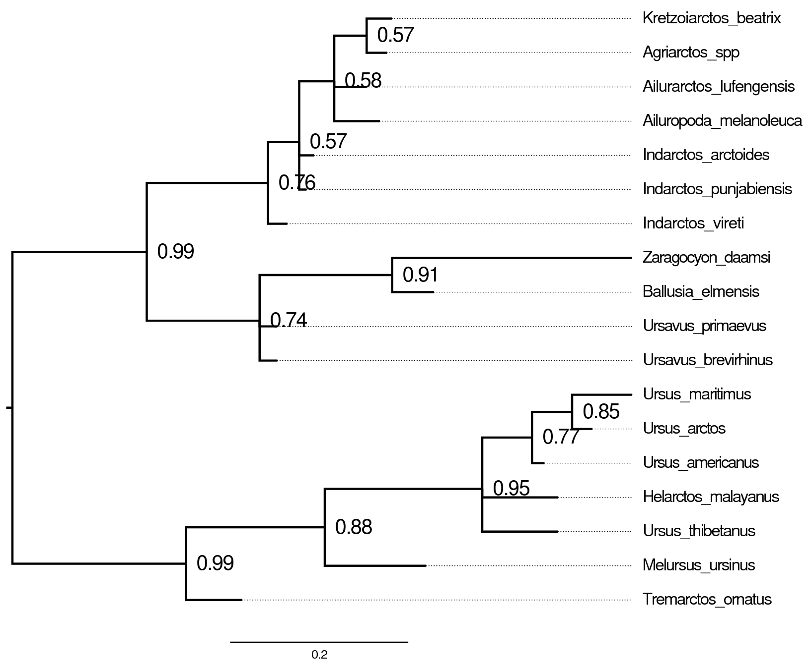



The Mk model makes a number of assumptions, but one that may strike you
as unrealistic is the assumption that characters are equally likely to
change from any one state to any other state. That means that a trait is
as likely to be gained as lost. While this may hold true for some
traits, we expect that it may be untrue for many others.

RevBayes has functionality to allow us to relax this assumption. Recall
from  that stationary frequencies impact how likely we
are to see changes in a character. For example, it may be very likely,
in a character, to change from 0 to 1. But if the frequency of 0 is very
low, we will still seldom see this change.

We can exploit the relationship between state frequencies and observed
changes to allow for variable Q matrices across characters
(). This tutorial shows how to do this
for binary characters using a **discretized Beta distribution**. This is
an example of a **mixture model**: there are assumed to be subdivisions
in the data, which may require different parameters (in this case,
state frequencies). These subdivisions are not defined *a priori*. The
model has previously been shown to be effective for a range of empirical
and simulated datasets .




Graphical model demonstrating the
discretized Beta distribution for allowing variable state frequencies.



We continue to build on the bears dataset and the Gamma-ACRV model from
.



>Make a copy of `model_ACRV_gamma.Rev` and call it **model_freqs_beta.Rev**.
>Make a copy of `mcmc_mkv_gamma.Rev` and call it **mcmc_mkv_beta.Rev**. You
>will need to modify the `Rev` code provided in this section in these files.
{:.instruction}

We will use a discretized Beta distribution to place a prior on state
frequencies. The Beta distribution has two parameters, $\alpha$ and
$\beta$. These two parameters specify the shape of the distribution.
State frequencies will be evaluated according to this distribution, in
the same way that rate variation is evaluated according to the Gamma
distribution. The discretized distribution is split into multiple
classes, each with its own set of frequencies for the 0 and 1 characters.
The number of classes can vary; we have chosen 5 for tractability. Note
that we need to make sure that this discretization results in a
symmetric model, therefore we will use only one parameter for the Beta
distribution: `beta_scale` so that $\alpha = \beta$.

num_cats = 5

Second, we specify the parameter of the Beta distribution. This
parameter `beta_scale` is drawn from a lognormal distribution, similar
to the suggestion of the prior on Gamma rate categories .

beta_scale ~ dnLognormal( 0.0, sd=2*0.587405 )
beta_scale.setValue( 1.0 )
moves.append( mvScale(beta_scale, lambda=1, weight=5.0 ) )

Next, we set the categories to each represent a quadrant of the Beta
distribution specified by the `beta_scale`.

cats := fnDiscretizeBeta(beta_scale, beta_scale, num_cats)


Using these state frequencies, we will generate a new vector of Q
matrices. Because we are varying the state frequencies, we must use a Q
matrix generation function that allows for state frequencies to vary as
a parameter. We will, therefore, use the `fnF81` function.

for (i in 1:cats.size()) {
    Q[i] := fnF81(simplex(abs(1-cats[i]), cats[i]))
}

Additionally, in RevBayes we need to specify the probabilities that a site evolves according to one
of the $Q$-matrices. For this model the probabilities must be equal because we need to guarantee that
the model is symmetric. Thus, we use a `simplex` function to create a vector that sums to 1.0.

matrix_probs <- simplex( rep(1, num_cats) )


The only other specification that needs to change in the model
specification is the CTMC, which now takes the vector of Q matrices and
the `siteMatrices` argument telling it how likely each matrix is to
apply to any given character:

phyMorpho ~ dnPhyloCTMC(tree=phylogeny, siteRates=rates_morpho, Q=Q, type="Standard", coding="variable", siteMatrices=matrix_probs)
phyMorpho.clamp(morpho)


>Remember to change all output filenames, e.g., from `output/mkv_gamma.log`
>to `output/mkv_beta.log`.
{:.instruction}

Run `mcmc_mkv_beta.Rev`. This estimation will take longer than the
previous ones, due to increased model complexity.








Assessing convergence using `convenience` . Here we show the difference in split frequencies. These runs have converged for us.





We will use `Tracer` to evaluate the MCMC samples from our three
estimations (`mkv`, `mkv_gamma`, `mkv_beta`). Load all three of the MCMC
logs into the `Tracer` window. Highlight all three files in the upper
left-hand viewer () by right- or command-clicking
all three files.




Highlight all three files for model comparison.



Once all three trace logs are loaded and highlighted, first look at the
estimated likelihoods. You will notice that the plain Mkv model is
improved by allowing rate heterogeneity, and improved further still by
also allowing state-frequency heterogeneity ().
Likely, we would need to perform stepping-stone model assessment to
truly tell whether the more complicated model is statistically
justified; you will find instructions for performing that analysis in
.




Comparison of likelihood scores for all three models.



Click on the `Trace` panel. In the lower left hand corner, you will
notice an option to color each trace by the file it came from. Choose
this option (you may need to expand the window slightly to see it). Next
to this option, you can also see an option to add a legend to your trace
window. The results of this coloring can be seen in
. When the coloring is working, you will see that
the plain Mkv model mixes quite well, but that mixing becomes worse as we
relax the assumption of equal state frequencies. This is because we are
greatly increasing model complexity. Therefore, we would need to run the
MCMC chains longer if we were to use these analyses in a paper.




The Trace window. The traces are colored by which version of the Mk model
they correspond to.



We are also interested in characterizing the degree of heterogeneity
estimated by the beta-discretized model. If the data were distributed by
a single morphological rate matrix, then we would expect to see very
little variation among the different values in `cats`, and a very large
value for `beta_scale`. For example, if `beta_scale` were 1000, then
that would cause all discrete-beta categories to have values approaching
0.5, which approximates a symmetric Mkv model.




Posterior discretized state frequencies for the discrete-beta model.






Posterior alpha and beta parameters for the discrete-beta model.



 shows that the four discrete-beta state
frequencies do not all have the exact same value. In addition,
 shows that the prior on `beta_scale` is small
enough that we expect to see variance among `cats` values. If the data
contained no information regarding the distribution of `cats` values,
then the posterior estimate for `beta_scale` would resemble the prior.




Majority rule consensus tree for the beta-discretized Mkv analysis.



The majority-rule consensus trees for the plain Mkv model and the
beta-discretized model are very similar ().
In general, it is important to assess whether your results are sensitive
to model assumptions, such as the degree of model complexity, and any
mechanistic assumptions that motivate the model's design. In this case,
our tree estimate appears to be robust to model complexity.



The discretized-Beta model only applies to binary characters, because a
Beta distribution describes the frequencies of just two states. A
natural idea for multistate characters is to draw the state frequencies
of each category from a Dirichlet distribution instead, similar to the
CAT model for molecular data . However, such a
model has to respect one important property of morphological data: the
state labels are arbitrary. Whether the authors of a matrix call a
particular condition "0", "1", or "2" is a matter of convention, so the
likelihood must not change when the states of a character are
relabelled.

For binary characters, the discretized-Beta model guarantees this
through the constraint $\alpha = \beta$. Because the Beta distribution
is then symmetric, its categories come in mirrored pairs: for every
category in which state 0 has frequency $q$, there is another in which
it has frequency $1-q$. Swapping the labels 0 and 1 therefore only swaps
categories within the mixture and leaves the likelihood unchanged.

For a character with $k$ states, the same guarantee would require every
set of frequencies in the mixture to be accompanied by all of its $k!$
possible relabellings: 6 for a three-state character and 24 for a
four-state character. Simply drawing frequencies from a symmetric
Dirichlet distribution is not enough, because each individual draw is
still asymmetric. A Dirichlet mixture model for multistate characters
would therefore be wrong. For example, if we relabel the states of a
character, say swap state 0 and 2, the likelihood would differ even
though the data themselves are exactly the same. For this reason,
we do not use such a model in these tutorials. In the activity below,
we instead combine the Beta mixture for the binary characters with the
standard Mk model for the multistate characters.



As discussed above, the discretized-Beta model only applies to binary
characters. Most real morphological matrices, however, mix binary and multistate characters,
like the cinctan dataset from . The
partitioning scheme from that page gives us a natural way to combine the
two: since every state-count partition already gets its own Q matrix, we
can give the **binary** partition the mixture of asymmetric F81 matrices
from this page, while every partition with three or more states keeps
its `i`-by-`i` Jukes-Cantor matrix.

>Make a copy of `model_multistate_partition.Rev` and call it
>**model_multistate_beta.Rev**. Make a copy of `mcmc_multistate.Rev` and
>call it **mcmc_multistate_beta.Rev**, and change it to source
>`model_multistate_beta.Rev` and write its output to
>`output/multistate_beta.*`.
{:.instruction}

Try to modify `model_multistate_beta.Rev` yourself before looking at the
solution. You will need to:

1. Set up `beta_scale`, the discretized Beta categories `cats`, the
   vector of F81 matrices, and `matrix_probs` exactly as in
   , *before* the loop over state counts.
   (Give the vector of Q matrices a different name, such as `Q_binary`,
   so that it does not clash with the Q matrices of the other partitions.)
2. Inside the loop, check whether the current partition is the binary
   one (`i == 2`). If it is, pass the vector of F81 matrices and
   `siteMatrices=matrix_probs` to `dnPhyloCTMC`; otherwise, use
   `fnJC(i)` as before.
3. Keep sharing the same tree and the same Gamma-distributed ACRV
   (`rates_morpho`) across all partitions.

The solution is provided as
[`model_multistate_beta.Rev`](scripts/model_multistate_beta.Rev) and
[`mcmc_multistate_beta.Rev`](scripts/mcmc_multistate_beta.Rev). The key
change is the `if` statement inside the loop:

        if (i == 2) {
            # binary characters: a mixture of F81 matrices with
            # Beta-distributed state frequencies
            m_morph[idx] ~ dnPhyloCTMC( tree=phylogeny,
                                        Q=Q_binary,
                                        siteMatrices=matrix_probs,
                                        nSites=nc,
                                        siteRates=rates_morpho,
                                        type="Standard")
        } else {
            # multistate characters: an i-by-i Jukes-Cantor matrix
            m_morph[idx] ~ dnPhyloCTMC( tree=phylogeny,
                                        Q=fnJC(i),
                                        nSites=nc,
                                        siteRates=rates_morpho,
                                        type="Standard")
        }


Run `mcmc_multistate_beta.Rev`, then load `output/multistate.log` (from
) and `output/multistate_beta.log`
into `Tracer`, and consider:

- Does the posterior of `beta_scale` differ from its prior? Small values
  mean the binary characters have strongly unequal state frequencies;
  very large values mean the model is close to the symmetric Mk model.
- How do the likelihood and `tree_length` compare between the two
  analyses?
- Do the summary trees differ?

As an extension, try adding ascertainment-bias correction
(`coding="variable"`) to every partition, as described in
.

When you are ready, move on to ,
where we relax another assumption of the Mk model: that a
character's rate of evolution never changes over time.
